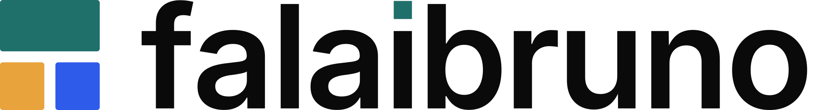

# FalaiBruno: contexto e design

> **Fonte única: Notion** (documento do canal v2, 18/10/2026, atualizado em 18/11/2026). Este arquivo é a cópia de trabalho do Edvid para edição. Se divergir do Notion, o Notion vale: atualize aqui. Cópia antiga no Drive: `Contexto/falaibruno.md`.
>
> **[HIPÓTESE]** = inferência a validar. **[PROPOSTA]** = decisão que o Bruno ainda precisa aprovar. Aprovados em 18/10/2026: série "Hype ou Negócio?" e assinatura "Falai, o que você acha?".
>
> A v2 incorpora o estudo de 10 referências (página Referenciais no Notion) e o mix de voz escolhido pelo Bruno.

_Cópia sincronizada em 2026-11-22._

## Ficha rápida para edição

Resumo do que mais pesa na hora de editar. O detalhe e o porquê estão nas seções abaixo.

| Item | Regra |
| --- | --- |
| Tela | 1080 × 1920, 30 fps, mesmo arquivo no Reels e no TikTok |
| Zona segura | Livres ~248 px no topo, ~448 px na base, ~152 px na direita, ~64 px na esquerda (área útil ~864 × 1224) |
| Formatos | Curto 30–45 s (3–5 reganchos) · Análise 90–150 s (8–15 reganchos, tela dividida) |
| Ritmo | Corte ou mudança visual a cada 2–4 s; regancho falado a cada 5–10 s com mudança visual junto |
| Zoom | Punch-in de 10–15%, no máximo 1 a cada 5 s |
| Transições | Corte seco ou deslize reto. Sem gradiente, brilho, sombra ou 3D |
| Legenda queimada | Sempre ligada. Inter SemiBold 64–72 px, 2–4 palavras por vez, branca, um pouco abaixo do meio. 1 palavra-chave por frase em Âmbar #E8A33D (no escuro) ou marca-texto âmbar com texto preto (no claro). Sem contorno nem sombra |
| Manchete do gancho | Até 8 palavras, caixa de frase, branco sobre faixa preta reta, terço superior da zona segura |
| Fonte na tela | Veículo + data, Inter Regular 30–32 px, cinza secundário, sempre que aparecer número |
| Cores | Base preto #0A0A0A / branco / cinzas; Petróleo #1F6F6B (sucesso), Âmbar #E8A33D (destaque), Cobalto #2F5BEA (informação). Nunca texto âmbar sobre branco |
| Fonte | Só Inter |
| Logo | Marca d'água: símbolo branco 48–64 px no canto superior esquerdo [PROPOSTA]; card final com assinatura de fundo escuro sobre preto |
| Som | Voz sempre em primeiro plano; música baixa sem letra; SFX curto só em virada e no selo do veredito |
| Fechamento | "Falai, o que você acha?" em todo vídeo |
| Proibido na tela | Emoji, exclamação, sombra, gradiente, crachá/tela/ambiente do trabalho, nome da empresa |

---

## 0. Quem é o Bruno (base fixa de autoridade)

Adicionado em 18/11/2026 (tarefa 07). É daqui que saem a autoridade no meio do vídeo e a "conexão com experiência pessoal" do Brief dos Conteúdos.

- **Formação:** Engenharia de Produção no IBMEC (Rio de Janeiro).
- **Mercado financeiro (2019 a 2024):** começou como trader de ações; num banco, ajudou a montar a mesa de operações de ações da tesouraria e foi o principal trader para fundos e clientes; num multi-family office, montou o trading de renda fixa e variável e participou do comitê de alocação; numa gestora independente, trabalhou com produtos e comercial.
- **Empreendedor com IA (2024):** saiu do mercado para estudar IA em tempo integral e criou a **Smart Legal**, uma legaltech com agentes de IA que escreviam peças para pequenas causas.
- **Hoje:** trabalha no comercial de uma empresa brasileira de IA (growth, vendas e parcerias). No canal, isso aparece só como "eu trabalho vendendo IA pra empresa", sem nome da empresa, cliente, preço ou número interno (ver seção 12).
- **Fora do trabalho:** surf e viagens de aventura. Objetivo pessoal: ser dono do próprio tempo, com liberdade financeira e geográfica (pilar Liberdade e estilo de vida).

**Repertório que dá autoridade (usar quando a pauta pedir):**

| Tema da pauta | Frase de autoridade possível |
| --- | --- |
| Bolsa, bolha, investimento, juros | "Eu passei 5 anos em mesa de operação. O que eu olho primeiro é…" |
| IA em empresa, ROI, adoção | "Eu trabalho vendendo IA pra empresa. A pergunta que mais aparece é…" (genérico, sem caso real) |
| Empreender, startup, produto com IA | "Eu já montei uma startup de IA do zero, e o que mais me custou foi…" |
| Jurídico, advogado, tribunal | "Eu criei uma legaltech com agentes. O risco que eu via de perto era…" |
| Carreira, mudar de área | "Eu saí do mercado financeiro pra estudar IA em tempo integral." |
| Liberdade, rotina, viagem | Surf e viagem como cenário, sempre ligados a uma tese (tempo, automação). |

- Não usar nome de banco, gestora ou family office no vídeo sem o ok do Bruno. [PROPOSTA]

## 1. Posicionamento

**"Eu trabalho vendendo IA pra empresa. Aqui eu te conto o que é negócio, o que é hype, e o que isso muda no seu dinheiro, na sua carreira e no seu tempo."**

A credencial é a experiência pessoal e genérica de quem está na linha de frente comercial (growth, vendas, parcerias). O nome da empresa não aparece como autoridade nem como propaganda.

## 2. Público

- Principal: brasileiro de 22 a 40 anos, CLT, autônomo ou pequeno empreendedor, curioso sobre IA e sem base técnica. [HIPÓTESE]
- Secundário: profissionais de vendas, marketing e negócios que querem usar IA no trabalho. [HIPÓTESE]
- Ponto de partida: IG com 45 seguidores e 4 posts; TikTok com 2 seguidores e 0 vídeos.

## 3. Promessa

"Você entende o que mudou em IA, por que importa pra você e o que fazer, contado por quem vê a IA sendo comprada e vendida de verdade."

## 4. Pilares

Notícia traduzida · IA na prática · Carreira e trabalho · Negócios e vendas · Liberdade e estilo de vida. (Iguais à v1; a Voz define o jeito de contar.)

## 5. Mix de voz (escolhido pelo Bruno)

| Voz | Peso | O que é | Base nas referências | Formato típico |
| --- | --- | --- | --- | --- |
| **A · O analista que vende IA** | ~60% (identidade) | Tom calmo e confiante. Opinião calibrada ("útil, mas cedo"), sempre "o que isso significa pra você". Separa hype de negócio com a lente de quem vende. | Precht (análise honesta, "eu testei") e Vicente (tese própria, pergunta pra levar pra vida), com a embalagem de Kallaway | Análise de 90 a 150 s, ou curto quando a tese é uma só |
| **B · Tradutor de notícia com opinião** | ~25% (notícias grandes) | Notícia grande em formato de história: superlativo ancorado em dado, virada, ângulo Brasil, opinião clara e pergunta polêmica no fim. Mais energia. | Belissimo (ângulo Brasil, autoridade no meio, fontes na legenda) e Kallaway/Vaibhav (reganchos, lista, "startup brasileira fez X") | Análise de 90 a 150 s |
| **C · Mão na massa** | ~15% (sempre com entregável real) | Demonstração de um uso concreto (prompt, planilha, mensagem pronta, fluxo) aplicado à vida brasileira (WhatsApp, Pix, MEI). Termina com algo real pra levar. | Tiago (a demonstração é a prova; visual com IA/Remotion) e Nick/AI Surfer (com moderação) | Curto de 30 a 45 s |

Regra de proporção: a cada 10 vídeos, cerca de 6 A, 2 a 3 B e 1 a 2 C. Se a fila sair do mix, ajusto a próxima pauta antes de gravar.

## 6. Tom e linguagem

- Primeira pessoa, falando com a câmera: "eu", "você", "a gente". Nunca "nós da empresa".
- Informal e culto, sem gíria pesada. "Cara" e "olha só" pontuais. Nada de "galera, se liga".
- **Um dado concreto a cada frase importante.** Superlativo só quando tem número ou fonte atrás.
- Inglês só quando o termo é mais conhecido que a tradução, e traduzido na primeira vez ("agente, que é uma IA que age por você").
- Opinião calibrada: digo o que acho e o grau de certeza ("negócio, mas cedo", "isso eu ainda não sei").
- Sempre o porquê: o que aconteceu → por que importa → o que você faz.
- Exemplos brasileiros: WhatsApp, Pix, CLT, MEI, INSS, vestibular, grupo da família.
- Política partidária: fora. Se a notícia tocar em eleição, falo da tecnologia e do cuidado, não de candidato.

### Vocabulário: usar e evitar

Adicionado em 18/11/2026. Baseado nas regras acima e no que funcionou (ou não) nas referências.

| Usar | Evitar | Por quê |
| --- | --- | --- |
| "Olha só", "cara" (pontual), "a gente" | "Galera, se liga", "fala, pessoal", "oi, gente" | Tom de conversa, sem abertura de youtuber |
| "Agente, que é uma IA que age por você" | Agente, LLM, prompt, ICP, unlock, bootstrapped sem tradução | Público sem base técnica |
| "Negócio, mas cedo", "isso eu ainda não sei" | "Revolucionário", "vai mudar tudo", "insano", "absurdo" sem dado | Opinião calibrada é a marca da voz A |
| Número com fonte ("segundo o BID, 82% das empresas…") | Superlativo solto ("a maior IA do mundo") | Um dado concreto por frase importante |
| WhatsApp, Pix, CLT, MEI, INSS, ENEM, grupo da família | Exemplos americanos sem tradução de contexto | Proximidade com o público |
| "Hype ou negócio?", "A Conta da IA" [PROPOSTA], "Do Zero #N" | Bordões de outras referências ("Amo você!") | Vocabulário próprio que o público passa a repetir |
| "Eu trabalho vendendo IA pra empresa" | "Nós da empresa", nome da empresa, cliente, preço | Fronteira da seção 12 |
| "Falai, o que você acha?" no fim de todo vídeo | "Compartilha pra todo mundo", "comenta PALAVRA" sem entregável | CTA aprovado; isca vazia queima confiança |
| "Eu testei", "eu fiz a conta" | "Dizem que…", "parece que…" | Prova vem de quem usa |

### Ganchos na voz do Bruno (exemplos)

- A: "Todo mundo comemorou esse lançamento. Eu trabalho vendendo IA pra empresa, e em um minuto eu te mostro por que isso ainda não vende."
- A: "80% das empresas brasileiras usam IA. Só 7% colocaram ela no centro do negócio. E o problema não é tecnologia."
- A: "Se você tem entre 18 e 29 anos, a IA já tá mexendo na sua vaga. Não sou eu que tô dizendo, é a FGV."
- B: "O Brasil acabou de decidir como a IA entra na escola do seu filho. E a regra mais polêmica nem é a que você imagina."
- B: "O FMI acabou de avisar: se a IA decepcionar, o tombo não fica na bolsa. Chega na economia real."
- C: "Três áudios de WhatsApp. Foi o que bastou pra clonarem uma voz e levarem 16 mil reais. Eu montei a mensagem que protege a sua família."
- C: "Você tá usando IA errado: prompt não é pergunta, é especificação de trabalho. Olha a diferença."

## 7. Formatos

|  | **Curto** | **Análise** |
| --- | --- | --- |
| Duração | 30 a 45 s | 90 a 150 s |
| Uso | Voz C, ou A com uma tese só | Vozes A e B, série fixa |
| Reganchos | 3 a 5 | 8 a 15 |
| Visual | Falando com a câmera + texto grande na tela; demonstração em tela no C | Tela dividida: manchete/print/b-roll em cima, Bruno embaixo; faixa de manchete no meio |
| Legenda do post | Curta (1 a 3 linhas) + CTA | Mini-artigo: resumo, fontes e "o que ficou de fora do vídeo" |

Por quê: nas referências de credibilidade, a mediana de duração é de 111 s (Precht) e 132 s (Vicente), e eles têm o melhor alcance por seguidor (0,34 e 0,56 view por seguidor). Os vídeos de 25 a 40 s só dominam nos perfis de ferramenta grátis (Nick e AI Surfer).

Visual: Remotion e Claude Code para manchetes, cards e gráficos, como prova de que eu uso o que falo. [HIPÓTESE: o estudo cita que o Bruno já domina as duas ferramentas]

## 8. Estrutura de roteiro

1. **Gancho (0–3 s):** use uma das fórmulas da seção 10. Nada de "oi, gente".
2. **Contexto (3–10 s):** o fato em uma frase, com a fonte na tela.
3. **Desenvolvimento com regancho a cada 5–10 s:** cada bloco abre com uma virada ("Mas o número que me chamou atenção é outro", "E aqui fica sério", "Só que tem o lado B", "E não para por aí") e traz um dado ou um exemplo.
4. **Autoridade no meio (curto ~15–25 s; análise ~40–70 s), nunca no começo:** "Eu sou o Bruno, trabalho vendendo IA pra empresa, e aqui eu separo negócio de hype." Variações curtas: "Do lado de quem vende IA, o que eu vejo é…".
5. **Opinião / veredito:** o que eu acho e com qual grau de certeza.
6. **Fechamento com pergunta pessoal ou polêmica** + assinatura.
   - Assinatura **(aprovada pelo Bruno em 18/10/2026):** **"Falai, o que você acha?"**, em todo vídeo.
7. **"Comenta PALAVRA" só quando houver algo real pra entregar** (guia, prompt, planilha, mensagem pronta), no máximo em 1 a cada 3 vídeos. O entregável precisa estar pronto antes de publicar (no corpo da pauta, abaixo do roteiro) e alguém precisa responder as DMs. Sem entregável: só a pergunta.

Checklist antes de gravar: gancho de uma fórmula? regancho a cada 5–10 s? dado com fonte em cada bloco? autoridade no meio? opinião clara? fecha com pergunta? se tem "comenta", o entregável existe?

## 9. Série fixa: "Hype ou Negócio?" (aprovada em 18/10/2026)

Um lançamento ou notícia grande de IA por semana, julgado por quem vende IA.

- Formato: Análise de 90 a 120 s, voz A (ou B quando a notícia é muito grande). Toda quarta.
- Abertura fixa: cabeçalho na tela "HYPE OU NEGÓCIO? #N" e a frase "Hype ou negócio? Deixa eu te contar o que eu vejo do lado de quem vende."
- Estrutura: o que lançaram (1 frase + fonte) → o que prometem → o que realmente importa → a pergunta do comprador ("quem paga por isso e por quê?") → **Veredito** com selo na tela: HYPE / NEGÓCIO / CEDO PRA DIZER → pergunta pro público → assinatura.
- Por que: a série fixa com bordão e cabeçalho foi o maior estouro do estudo (Vicente, 21,6× a mediana). A pergunta "hype ou negócio" usa a credencial do Bruno sem expor a empresa e cria vocabulário que o público passa a usar.
- Tese recorrente [PROPOSTA]: **"A Conta da IA"**. IA que não muda o número de um processo é custo, não estratégia: escolhe um processo, mede, aplica IA, mede de novo. Repetir entre vídeos ("quem me acompanha já sabe da Conta da IA").
- Alternativa mensal: "Bastidores de quem vende IA", sempre genérico (o que as empresas perguntam, objeções comuns), sem cliente, número ou caso real.

## 10. Fórmulas de gancho

| # | Fórmula | Exemplo real | Versão FalaiBruno |
| --- | --- | --- | --- |
| 1 | "Tá todo mundo falando de X, e em N segundos você vai entender o que importa" | Precht | "Tá todo mundo falando do Gemini 4 Argon. Em um minuto eu te mostro o que muda pra quem trabalha." |
| 2 | Superlativo + virada | Kallaway, Vegas Sphere | "Esse é o rascunho mais importante de IA do ano. E a parte mais importante nem é a tecnologia." |
| 3 | Fonte privilegiada / bastidor | Vicente, grupo de Harvard | "A pergunta que toda empresa faz antes de comprar IA. E não é o preço." (genérico) |
| 4 | Frase-bomba de 3 a 5 palavras | Belissimo, Chase | "A IA virou custo." |
| 5 | Celebridade + conflito | Vaibhav, Vicente | "O FMI acabou de avisar…" / "O criador do Linux deixou a IA programar." |
| 6 | Brasil contra o mundo | Belissimo, Vaibhav | "Uma startup brasileira fez X que nem as gigantes fizeram." (só com caso público e verificado) |
| 7 | Benefício grátis e absoluto | Nick, AI Surfer | "Dá pra fazer isso no WhatsApp da sua empresa sem pagar nada." (só voz C, com entregável) |
| 8 | Duelo ao vivo | Tiago | "Duas IAs, a mesma tarefa de vendas. Qual fecha melhor?" |
| 9 | Objeto curioso + "olha só" | Jornadatop | "Isso aqui parece um app qualquer. Olha o que ele faz." (raro: só se tiver tese) |
| 10 | Ironia | Precht | "A maior ironia da IA esse ano: as empresas que mais usam são as que menos sabem quanto gastam." |
| 11 | Analogia do dia a dia brasileiro (seção 15) | vinig.talks | "Imagina você fazendo o ENEM…" (serve para A e B) |

## 11. O que pegar e o que evitar de cada referência

| Referência | Pegar | Evitar |
| --- | --- | --- |
| @beprecht | Análise honesta de lançamento ("o que realmente importa"), "eu testei", opinião calibrada, legenda de uma frase de opinião | Termos em inglês sem tradução (ICP, unlock, bootstrapped) pro público geral |
| @vicentecondee | Série com bordão e cabeçalho fixo, tese própria repetida, conceito com nome, pergunta pra levar pra vida, legenda mini-artigo com fonte | Vida pessoal sem ligação com a tese (alcance bem menor); bordão de fonte privilegiada que dependa da empresa |
| @brunobelissimo.ai | Ângulo Brasil, autoridade no meio, legenda com fontes e "o que ficou de fora", pergunta polêmica, tela dividida com faixa de manchete | Precisar se defender de lado político; emoção acima do dado; assinatura copiada ("Amo você!") |
| @tiagolemosx | A demonstração é a prova; visual com IA/Remotion; exemplos por profissão; frase-tese curta | Legenda só com CTA; funil de curso em todo vídeo; pouca opinião |
| @jornadatop | Linguagem simples pra grande público; manchete em caixa alta | Curiosidade sem tese, volume industrial (~5/dia), publi solta, hashtags genéricas |
| @kallaway | Disciplina de roteiro: virada de expectativa, dado a cada frase, analogia pra leigo, reganchos a cada 5–10 s, resumo "em português claro" | Superlativo sem número; legenda gigante repetindo o roteiro |
| @vaibhavsisinty | Lista numerada ("5 coisas que você precisa saber"), enquadramento "startup brasileira", série semanal numerada | Nacionalismo forçado; pedir "compartilha pra todo mundo" |
| @nick_saraev | Clareza de 30 s: benefício → prova social → como funciona → entrega | "Comenta PALAVRA" em 100% dos vídeos; virar catálogo de link e anúncio |
| @chase.h.ai | Explicar o mecanismo com analogia ("a IA escolhe a próxima palavra por probabilidade") e avisar quando simplifica | Funil de mentoria em todo post; tom técnico demais |
| @theaisurfer | Mostrar o entregável na tela ("escreve isso, recebe isso"); ângulo de liberdade (automatizar o que drena) | Fórmula repetida até saturar (mediana caiu pra 27 mil com 609 mil seguidores); isca sem valor |

## 12. Fronteira com a Dharma-AI

- Pode: IA em geral, mercado, ferramentas públicas, notícias, e a experiência pessoal genérica ("trabalho vendendo IA pra empresa").
- Nunca: informação interna, preços, propostas, números, nomes ou casos de clientes, roadmap, parceiros não públicos.
- Nunca como porta-voz: não falo em nome da empresa, não faço propaganda dela, não comento concorrentes dela nem produto parecido com o dela. A autoridade no meio do vídeo é genérica, sem citar a empresa.
- Na série "Hype ou Negócio?", não julgo produto de cliente, parceiro ou concorrente direto da Dharma.
- [PROPOSTA, 19/10/2026] Na série, também evito dar veredito sobre modelo ou produto de LLM de fronteira (OpenAI, Google Gemini, DeepSeek etc.), porque é o lado da comparação no discurso da Dharma. Lançamento de consumo (Apple, apps, bancos) e estudos de mercado ficam liberados.
- Na dúvida, não posta. [HIPÓTESE: confirmar se o contrato tem política de redes sociais ou conflito de interesse.]
- **Na edição:** nunca deixar aparecer crachá, tela, cliente, ferramenta ou ambiente do trabalho, nem o nome da empresa, em nenhum frame.

## 13. Frequência

**3 vídeos por semana, mesmo arquivo no Reels e no TikTok, por 8 semanas:**

- **Segunda:** Curto (C ou A).
- **Quarta:** Análise da série "Hype ou Negócio?" (A/B).
- **Sexta:** Análise ou Curto (A/B), conforme a notícia da semana.
- Horário: 19h–21h BRT. [HIPÓTESE: até termos dados próprios]

Por que manter 3 e não subir: as referências de credibilidade com o melhor alcance por seguidor postam cerca de 2 a 2,4 vezes por semana (Precht ~2,4; Vicente ~2,0). O volume de ~5 por dia do Jornadatop não constrói autoridade. Como 1 ou 2 vídeos por semana passam a ser Análise (mais trabalho de roteiro e edição), 3 por semana é o teto sustentável com trabalho em tempo integral. Gravação em lote no fim de semana (~2–3 h).

Reavaliar na semana 8. Subir para 4 por semana (+1 Curto) só se a gravação em lote estiver sustentável e os vídeos passarem de 1.000 views com frequência.

## 14. Rotina de pautas

- Banco "FalaiBruno Pautas" no Notion: Status, Voz, Formato, Pilar, Gancho, Fonte, Data prevista.
- **O roteiro completo fica no corpo da própria linha do banco no Notion** (fonte única desde 19/10/2026). Linhas antigas mantêm o link "cópia no Drive: Google Doc", que continua valendo.
- Manter sempre de 3 a 6 pautas em Roteiro ou Aprovado, respeitando o mix (~6 A : 2–3 B : 1–2 C).
- Toda pauta de notícia precisa de Fonte (URL) de veículo confiável. Conferir os números antes de gravar.
- **No Edvid:** o `briefing.md` de cada projeto aponta para a linha da pauta no Notion em vez de copiar o roteiro.

## 15. Sub-formato "Do Zero": construção em público (inspirado em @vinig.talks)

- **O que é:** bastidor honesto de quem constrói um canal (e uma vida com mais liberdade) do zero, com trabalho em tempo integral. Número real do canal, processo próprio, o que deu errado. Cenário de casa ou da viagem, celular na mão, edição simples.
- **Por quê:** no @vinig.talks (129 mil seguidores), o conteúdo próprio tem mediana de 59,2 mil views, contra 26,8 mil dos posts com marca. O maior estouro (2,02 mi, 46× a mediana) é uma notícia de IA explicada com analogia do ENEM, sem efeito nenhum. Os vídeos de "como eu faço" e "o que eu construí" chegam a 55 a 80 mil views, com centenas de comentários quando há entregável.
- **Como encaixa no mix (sem criar voz nova):** lição ou número do canal → **A**; processo com entregável → **C**. No máximo 1 a cada 2 semanas, ocupando um slot de segunda ou sexta (não soma vídeo à semana).
- **Regras:** numerado ("Do Zero #N"), sempre com um número real do próprio canal; nunca mostrar crachá, tela, cliente ou ferramenta do trabalho; nada de publi ou visita a empresa do mercado de IA.

---

# Guia da Marca / Design system

Design system v1.0 (novembro de 2026). As regras de vídeo (9:16, zonas seguras, capa, edição) não estão no PDF: são a aplicação dele ao Reels e ao TikTok, e as marcadas [PROPOSTA] pedem o ok do Bruno.

**Resumo em uma frase (do próprio PDF):** preto, branco e cinza como base. Petróleo, âmbar e cobalto com função. Uma fonte, formas retas.

## Arquivos da marca

O pacote completo do design system v1.0 (logos SVG e PNG, animações do símbolo, fonte Inter, tokens e componentes) está em [`marca/design-system/`](../marca/design-system/). O guia de qual arquivo usar em cada situação do vídeo está em [`marca/README.md`](../marca/README.md).

## Cores

**Base (carrega quase tudo):**

| Cor | HEX | Função | Regra |
| --- | --- | --- | --- |
| Branco | #FFFFFF | Fundo de páginas e telas; texto sobre preto, petróleo e cobalto | — |
| Preto | #0A0A0A | Texto principal, fundos escuros, blocos de destaque | Não é preto puro (#000) |
| Cinza 1 | #525252 | Texto secundário (7,8:1 no branco) | Único cinza que vira texto no claro |
| Cinza 2 | #8A8A8A | Ícones, estados inativos | Não é cor de texto |
| Cinza 3 | #D4D4D4 | Bordas e divisores | — |
| Cinza 4 | #F2F2F2 | Superfície de cards | — |

**Acentos (cada um com uma função):**

| Cor | HEX | Função | Texto em cima |
| --- | --- | --- | --- |
| Petróleo | #1F6F6B | Ação e sucesso; cor do bloco de cima do símbolo e do pingo do "i" | Branco (5,9:1). Funciona como texto no branco |
| Âmbar | #E8A33D | Destaque e atenção: marca-texto, selos, rótulos sobre preto | Preto (9,2:1). **Nunca texto âmbar sobre branco** (2,2:1) |
| Cobalto | #2F5BEA | Links, informação e foco | Branco (5,5:1). Funciona como texto no branco |
| Vermelho | #D92D20 | Só erro, sempre com texto | Não faz parte da marca |

**Versão escura (tokens):** fundo #0A0A0A · superfície #1A1A1A · texto #FFFFFF · texto secundário #A3A3A3 · borda #3A3A3A · petróleo claro #4FB3AC (com texto preto) · âmbar #E8A33D · cobalto claro #7C9BFF. Na versão clara: fundo #FFFFFF, superfície #F2F2F2, texto #0A0A0A, secundário #525252, borda #D4D4D4.

**Par de maior impacto:** âmbar no preto (9,2:1). É o par do vídeo.

**Como as cores entram no vídeo:**

- Fundo de card, tela dividida e capa: Preto #0A0A0A (padrão) ou Branco.
- Palavra-chave da legenda queimada: Âmbar sobre fundo escuro. Sobre imagem clara ou fundo branco, usar marca-texto (caixa âmbar com texto preto), nunca letra âmbar.
- Faixa de manchete: Preto com texto branco; rótulo (eyebrow) em Âmbar.
- Gráficos (Remotion): dado principal em Petróleo, comparação em Cobalto, o número que importa em Âmbar, o resto em Cinza 2/3.
- Card "Entregável" (voz C): superfície inversa, Preto com rótulo Âmbar, como no componente "Inverso" do PDF.
- **Selos do veredito (Hype ou Negócio?) [PROPOSTA]:** HYPE em Âmbar com texto preto (atenção) · NEGÓCIO em Petróleo com texto branco (sucesso) · CEDO PRA DIZER em Cobalto com texto branco (informação). Vermelho fica de fora porque não é cor da marca.

## Tipografia

**Uma família só: Inter** (gratuita, Google Fonts; no Remotion, via pacote de Google Fonts). Pilha: "Inter", ui-sans-serif, system-ui, -apple-system, "Segoe UI", Arial, sans-serif.

- Light 300: grandes títulos de impacto. SemiBold 600: hierarquia. Regular 400: leitura. Também disponíveis: Italic 400, Medium 500, Bold 700.
- Ênfase vem de peso ou cor, nunca de um tamanho novo.

**Escala do PDF (telas/web):**

| Estilo | Tamanho / entrelinha | Peso | Espaçamento |
| --- | --- | --- | --- |
| display-xl | 72 / 1,05 | Light 300 | −0,02em |
| display | 56 / 1,05 | SemiBold 600 | −0,02em |
| h1 | 40 / 1,1 | SemiBold 600 | −0,01em |
| h2 | 28 / 1,2 | SemiBold 600 | — |
| h3 | 20 / 1,3 | SemiBold 600 | — |
| lead | 20 / 1,5 | Regular 400, cor secundária | — |
| body | 16 / 1,5 | Regular 400 | — |
| small | 14 / 1,5 | Regular 400, cor secundária | — |
| eyebrow | 12 / 1,4 | SemiBold 600, CAIXA ALTA | +0,08em |

**Escala para vídeo 1080 × 1920 [PROPOSTA]** (a escala do PDF multiplicada por ~2 para leitura no celular):

| Uso no vídeo | Estilo base | Tamanho | Peso |
| --- | --- | --- | --- |
| Manchete do gancho / número gigante | display-xl | 140–160 px | Light 300 (número) ou SemiBold 600 (frase) |
| Título de card / tela dividida | display | 96–112 px | SemiBold 600 |
| Legenda queimada | h1 | 64–72 px | SemiBold 600 |
| Rótulo de série ("HYPE OU NEGÓCIO? #6", "DO ZERO #3") | eyebrow | 32–36 px | SemiBold 600, caixa alta, +0,08em |
| Fonte e data na tela | small | 30–32 px | Regular 400, Cinza secundário |

**Regras de texto do PDF (valem para tela, capa e carrossel):**

- Títulos em caixa de frase, até oito palavras, uma ideia por título. Caixa alta só no rótulo (eyebrow).
- Números no padrão brasileiro: 91,2% · 1,2M · intervalos com meia-risca: 24–48h.
- Sem emoji nem exclamação no texto da marca.
- Dado ainda desconhecido fica entre colchetes: [X]%.

## Formas, espaçamento e componentes

- **Formas retas.** Raios de 0 a 8 px: 0 em faixas e imagens; 2 px em tags e rótulos; 4 px em botões e barras; 6 px em cards (padrão); 8 px no máximo.
- **Sem sombras, sem gradientes, sem bordas laterais coloridas.** Superfícies se separam por cor ou por borda de 1 px (Cinza 3; 2 px só para foco).
- Espaçamento em base 4 px: 4 · 8 · 12 · 16 · 24 · 32 · 48 · 64 · 96. Grid de 12 colunas, gutter 24 px, margem lateral de 24 px no celular e 96 px no desktop.
- **Cards:** Preenchido (Cinza 4, raio 6, padding 32) para o conteúdo principal ("O que acontece"); Contorno (borda 1 px Cinza 3) para o secundário; Inverso (Preto com rótulo Âmbar) para o ponto mais importante da tela ("Entregável").
- **Tags:** raio 2 px, retangulares; status sempre com palavra, nunca só cor (CONCLUÍDO, EM ATENÇÃO, INFORMAÇÃO, ERRO).
- Botões: raio 4 px, altura mínima 44 px, texto SemiBold; destaque em Petróleo, no máximo um por tela; foco em Cobalto.

## Logo

Um símbolo de três blocos (petróleo em cima, âmbar e cobalto embaixo) e o wordmark "falaibruno", em minúsculas, com o pingo do "i" quadrado em petróleo: um sinal discreto de IA. Em texto corrido, escreva **FalaiBruno**.

**As 13 versões** (arquivos em `marca/design-system/assets/Logos/`, `.svg`, e `Logos PNG/`, `.png`; nomes: `assinatura-*`, `falaibruno-*` para o wordmark, `simbolo-*`, `avatar-*`, com sufixos `-preto` para fundo claro, `-branco` para fundo escuro e `-mono-preto`/`-mono-branco`):

| Versão | Cores | Quando usar |
| --- | --- | --- |
| Assinatura · fundo claro (principal) | Símbolo colorido + wordmark preto, pingo petróleo | Padrão em fundo branco ou claro |
| Assinatura · fundo escuro | Símbolo colorido + wordmark branco, pingo petróleo | Padrão em fundo preto (card final do vídeo, capa escura) |
| Assinatura all black | Tudo preto | Uma cor, fundos claros, impressão |
| Assinatura all white | Tudo branco | Uma cor, fundos escuros ou coloridos (petróleo, âmbar, cobalto, foto) |
| Wordmark · fundo claro | Preto, pingo petróleo | Espaços estreitos ou quando o símbolo já está perto |
| Wordmark · fundo escuro | Branco, pingo petróleo | Idem, sobre preto |
| Wordmark mono preto | Tudo preto | Uma cor, fundo claro |
| Wordmark mono branco | Tudo branco | Sobre cor da marca ou foto |
| Símbolo · cor | Três blocos coloridos | Favicon, avatar, carimbo pequeno |
| Símbolo · preto | Preto | Carimbo em fundo claro, uma cor |
| Símbolo · branco | Branco | Carimbo sobre preto, cor ou vídeo |
| Avatar/favicon · fundo branco | Símbolo colorido em quadrado branco | Foto de perfil, favicon |
| Avatar/favicon · fundo preto | Símbolo colorido em quadrado preto | Foto de perfil, favicon |

**Regras do PDF:**

- Assinatura (símbolo + wordmark) é o padrão. Wordmark sozinho em espaços estreitos ou quando o símbolo já está perto. Símbolo sozinho em favicon, avatar e carimbos pequenos.
- Respiro: em volta, no mínimo a altura do bloco âmbar.
- Tamanho mínimo: símbolo a partir de 16 px; assinatura a partir de 80 px de largura.
- Não redesenhe, recolore, estique, contorne ou aplique sombra. Sobre petróleo, âmbar ou cobalto, use a versão mono (branca).

**Animação do símbolo:** o F de Falai vira o B de Bruno, ~5 s em loop, 480×480, 25 fps (`marca/design-system/assets/Animações/`). `animacao-v2` é a leitura mais clara do F. Só o símbolo anima, nunca o wordmark, e nunca abaixo de 64 px.

**No vídeo [PROPOSTA]:** marca d'água com o símbolo branco pequeno (48–64 px) no canto superior esquerdo, dentro da zona segura; card final com a assinatura de fundo escuro sobre Preto; capa com o símbolo (não a assinatura inteira) para não competir com o título.

## Formato e zonas seguras (Reels e TikTok, 9:16)

O PDF não trata de vídeo; esta parte segue as zonas das plataformas, já ajustada à grade do PDF (base 4 px, margem de 24 px no celular).

- Tela: **1080 × 1920 px**, 30 fps. Mesmo arquivo no Reels e no TikTok.
- **Zona segura** (onde texto e rosto não são cobertos pela interface): deixar livres cerca de **248 px no topo**, **448 px na base** (legenda do post, nome, música), **152 px na direita** (botões) e **64 px na esquerda**. Sobra uma área útil de cerca de 864 × 1224 px no centro.
- A capa do grid do Instagram corta para 3:4 (1080 × 1440) no perfil: título e rosto no terço central.

## Texto na tela

- **Manchete do gancho (0–3 s):** até 8 palavras em caixa de frase, no terço superior da zona segura, branco sobre faixa preta reta (raio 0). Repete a promessa do gancho, não transcreve a fala.
- **Legenda queimada:** sempre ligada. Inter SemiBold, 2 a 4 palavras por vez, branca, centralizada um pouco abaixo do meio da tela, acima da zona da base. Uma palavra-chave por frase em Âmbar (no escuro) ou em marca-texto Âmbar com texto preto (no claro). Sem contorno nem sombra: se a imagem atrás for clara, usar caixa preta atrás da legenda.
- **Fonte na tela:** nome do veículo + data, estilo small, sempre que aparecer um número.
- **Análise:** tela dividida (manchete/print/gráfico em cima, Bruno embaixo), separada por faixa preta com o título, como na seção 7.
- **Série:** rótulo eyebrow "HYPE OU NEGÓCIO? #N" em Âmbar sobre Preto no topo nos primeiros segundos; selo do veredito em tela cheia no fechamento (cores acima).
- **Do Zero:** rótulo "DO ZERO #N" e o número real do canal em display-xl (Light 300).

## Capa / thumbnail

- Fundo: frame do Bruno olhando para a câmera, com faixa preta reta para o título, ou fundo Preto liso.
- Título em Inter SemiBold, caixa de frase, 3 a 5 palavras, dentro do recorte 3:4. Sem emoji, sem exclamação, sem sombra.
- Rótulo da série ou do Do Zero em Âmbar no topo do recorte; mesmo molde em toda capa da série, mudando só número e título, para o grid ficar reconhecível.
- Símbolo pequeno no canto, sem competir com o título.

## Edição e B-roll

- Ritmo: corte ou mudança visual a cada 2 a 4 s; regancho falado a cada 5 a 10 s (seção 8) com mudança visual junto.
- Zoom leve (punch-in de 10 a 15%) para marcar ênfase, no máximo 1 a cada 5 s.
- Transições: corte seco ou deslize reto. Sem gradiente, brilho, sombra ou 3D (regra do PDF).
- B-roll: print da manchete real, gráfico feito no Remotion na paleta, tela do celular/computador na voz C. Evitar banco de imagem genérico de "robô azul".
- Som: voz sempre em primeiro plano; música baixa sem letra; SFX curto só em virada e no selo do veredito.
- Cenário: casa ou viagem, luz de janela de frente, celular na vertical na altura dos olhos. Nunca crachá, tela ou ambiente do trabalho.

## Tom visual

Limpo, reto e direto: base preta, branca e cinza, um acento por tela com função clara, uma fonte, nada de sombra ou gradiente. Número grande quando o dado é a notícia. O visual serve à tese, igual à fala.

---

# Ainda em aberto para o Edvid

- **Ferramenta de edição principal**: [A PREENCHER] (CapCut, Premiere, DaVinci, Final Cut?). Remotion e Claude Code aparecem para manchetes, cards e gráficos [HIPÓTESE].
- **Codec e bitrate de exportação**: [A PREENCHER] (sugestão: H.264, MP4, 1080 × 1920, 30 fps).
- **Onde ficam brutos e exportados** (nuvem): [A PREENCHER]
- **Nomenclatura de arquivos**: sugestão `AAAA-MM-DD_nome-curto_formato_v1.mp4` [PROPOSTA]
- **Música e SFX liberados** (biblioteca/fonte): [A PREENCHER]

## Checklist antes de publicar

- [ ] Gancho de uma fórmula, com manchete na tela nos primeiros 3 s
- [ ] Regancho a cada 5–10 s, com mudança visual junto
- [ ] Fonte na tela sempre que aparece um número
- [ ] Autoridade no meio, nunca no começo
- [ ] Legendas revisadas (ortografia, sincronia, dentro da zona segura, palavra-chave em âmbar)
- [ ] Voz em primeiro plano, música baixa sem letra
- [ ] Só Inter, cores da marca, sem sombra, gradiente, emoji ou exclamação
- [ ] Nada do trabalho no frame (crachá, tela, cliente, nome da empresa)
- [ ] Fecha com "Falai, o que você acha?"; se tem "comenta PALAVRA", o entregável existe
- [ ] Capa no molde, legível no recorte 3:4
- [ ] Exportado em 1080 × 1920, 30 fps
